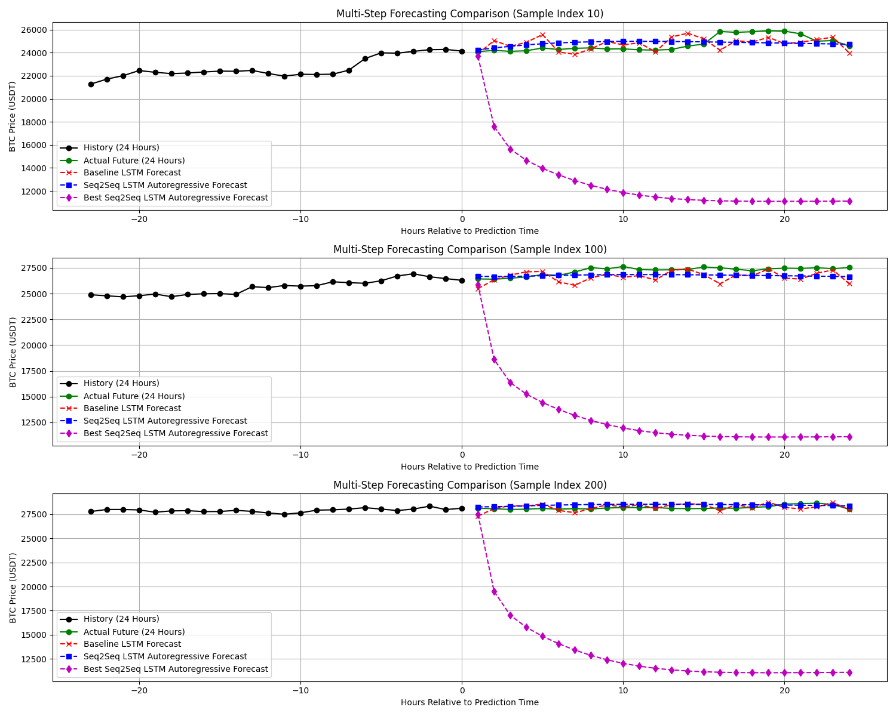
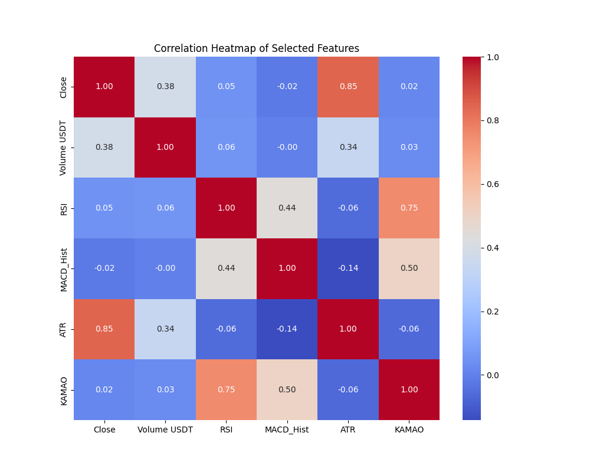
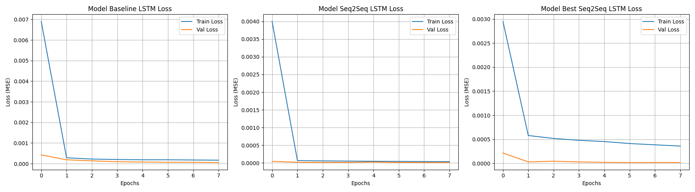

# Bitcoin Multi-Horizon LSTM Forecasting

Forecasting the next 24 hourly Bitcoin closing prices from the previous 24 hours of market data and technical indicators. This project compares a direct LSTM baseline, an encoder-decoder Seq2Seq LSTM, and a larger bidirectional/stacked Seq2Seq experiment.

**Author:** Muhammad Akhtar Ariq

**Context:** Final submission for Deep Learning Terapan untuk Time Series (DLTM).

## Highlights

- Six input features and a 24-step forecast horizon.
- Chronological train/validation/test splits, with scalers fitted only on training data.
- A serializable `CustomDense` layer implemented with TensorFlow operations.
- Custom training loops using `tf.GradientTape`, `tf.function`, Adam, and MSE loss.
- Teacher forcing during Seq2Seq training and autoregressive decoding during test evaluation.
- Saved model artifacts, feature correlations, training curves, and forecast comparisons.

## Recorded results

These values come from the notebook's saved outputs; they have not been recomputed for this repository preparation. MAE and RMSE are calculated after inverse scaling to the original USDT price scale, across the test windows and all 24 forecast steps.

| Model | Test MAE (USDT) | Test RMSE (USDT) | Prediction method |
| --- | ---: | ---: | --- |
| Baseline LSTM | 360.25 | 495.04 | Direct 24-step output |
| **Standard Seq2Seq LSTM** | **325.43** | **462.72** | Autoregressive |
| Bidirectional/stacked Seq2Seq | 14,736.61 | 15,253.24 | Autoregressive |

The standard Seq2Seq model achieved approximately **9.67% lower MAE** and **6.53% lower RMSE** than the direct LSTM baseline in the recorded run. The files and notebook label the larger experiment as "Best", but it did **not** achieve the best test performance.



The larger model's poor forecasts make the difference between teacher-forced validation and autoregressive evaluation an important discussion point. Its second decoder LSTM's recurrent states are discarded between forecast steps in the current inference function; investigating consistent state handling is a useful next experiment. This repository preserves the submitted implementation and results.

## Data and methodology

The notebook expects a local file named `Bitcoin3.csv`. The original dataset is **not included** in this repository, and its source URL and redistribution license are not recorded in the supplied project files.

The saved notebook describes 53,150 observations from **2017-09-21 09:00** through **2023-10-19 23:00**, with these columns:

| Column | Role |
| --- | --- |
| `Date` | Timestamp, parsed and sorted chronologically |
| `Close` | Input feature and forecast target |
| `Volume USDT` | Input feature |
| `RSI` | Input feature |
| `MACD_Hist` | Input feature |
| `ATR` | Input feature |
| `KAMAO` | Input feature |

The notebook consumes the existing indicator columns; it does not calculate them from raw market prices.

1. Sort observations by timestamp and inspect missing values and correlations.
2. Split observations chronologically: 80% training (42,520 rows), 10% validation (5,315), and 10% testing (5,315).
3. Fit separate feature and target `MinMaxScaler` instances on training data only.
4. Build windows independently within each split: 24 input steps by six features and 24 target steps by one target.
5. Train each model for eight epochs with a batch size of 128, restoring weights with the lowest validation loss.
6. Evaluate on 5,268 test windows and compare forecasts with actual prices.



## Architectures

| Model | Main layers |
| --- | --- |
| Baseline | LSTM(64), CustomDense(24), reshape to 24 by 1 |
| Standard Seq2Seq | LSTM(64) encoder, LSTM(64) decoder, TimeDistributed(CustomDense(1)) |
| Larger Seq2Seq experiment | Bidirectional LSTM(64), LSTM(128) encoder, LSTM(128) and LSTM(64) decoder layers, dropout(0.2), TimeDistributed(CustomDense(1)) |



Despite its filename, `accuracy_loss_plot.png` shows **MSE loss**, not classification accuracy. Seq2Seq validation uses teacher forcing, while test predictions use autoregressive decoding, so the validation curves alone do not measure free-running forecast quality.

## Repository contents

| File | Purpose |
| --- | --- |
| [Project notebook](muhammad%20akhtar%20ariq_submission_akhir_dltm.ipynb) | Data preparation, model definitions, training, evaluation, and saved outputs; narrative and comments are primarily Indonesian |
| `model_baseline_lstm.keras` | Saved direct LSTM baseline |
| `model_seq2seq_lstm.keras` | Saved standard Seq2Seq model, strongest in recorded test evaluation |
| `best_model_seq2seq_lstm.keras` | Saved larger bidirectional/stacked experiment |
| `predictions_vs_actual_plot.png` | Forecast comparisons for three selected test windows |
| `accuracy_loss_plot.png` | Training and validation loss curves |
| `correlation_heatmap.png` | Feature correlation analysis |
| `requirements.txt` | Original dependency list |
| [PORTFOLIO.md](PORTFOLIO.md) | Ready-to-use project summary, showcase recommendations, and technology list |

The local files `seq2seq_lstm_model.keras` and `best_seq2seq_lstm_model.keras` are byte-identical duplicates of their corresponding canonical model files and are excluded from Git.

## Run locally

Use Python 3.12 to match the notebook's recorded interpreter. The saved outputs report TensorFlow 2.21.0, and the model archives record Keras 3.14.1. The supplied requirements use broad version constraints rather than a locked environment.

```powershell
python -m venv .venv
.\.venv\Scripts\python.exe -m pip install -r requirements.txt
.\.venv\Scripts\python.exe -m notebook
```

1. Obtain the original `Bitcoin3.csv` dataset with the columns listed above and place it beside the notebook. The notebook also checks the parent directory.
2. Open `muhammad akhtar ariq_submission_akhir_dltm.ipynb` and select the virtual environment's Python kernel.
3. Run the cells in order to prepare data, train all three models, evaluate, and regenerate the plots and model files.

You can inspect the committed notebook outputs and images without the dataset. Full execution requires the missing CSV. Training can run on CPU; the saved run reports no available GPU.

The notebook's save calls use uppercase `LSTM` in filenames, while the supplied artifacts use lowercase `lstm`. On case-sensitive systems, rerunning may create additional files with those uppercase names.

### Loading saved models

Execute the notebook's `CustomDense` definition before using `tf.keras.models.load_model(...)`, so Keras can resolve the registered custom layer. Training scalers are not saved as separate artifacts, so preprocessing must be reconstructed from the original training split. Seq2Seq forecasting also requires the encoder and stepwise decoder logic from the notebook; loading the two-input training model alone does not provide a standalone forecasting interface.

## Technologies

Python, TensorFlow, Keras, NumPy, pandas, scikit-learn, Matplotlib, Seaborn, Jupyter Notebook, and IPython display utilities. Git and GitHub provide version control and repository hosting.

## Limitations and next steps

- The dataset is missing, so the original training and evaluation cannot be reproduced from this checkout alone.
- Random seeds are not fixed, and dependency versions are not fully pinned; fresh training results may differ.
- Forecast windows overlap, and metrics aggregate all horizons. Add per-horizon metrics and a persistence baseline for a more informative comparison.
- Check timestamp gaps before interpreting every 24-observation sequence as exactly 24 continuous hours.
- Investigate recurrent-state handling in the stacked decoder and evaluate validation forecasts autoregressively before selecting a model.
- Export the fitted scalers and a complete inference interface to make the saved models easier to reuse.
